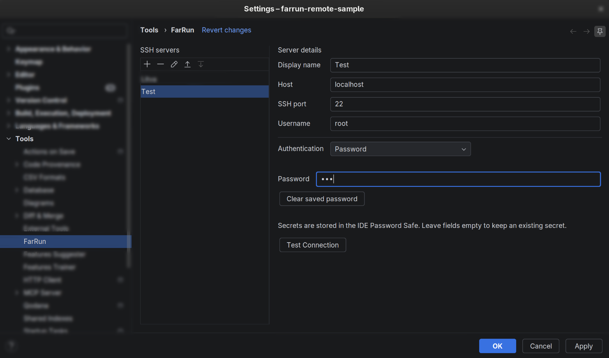
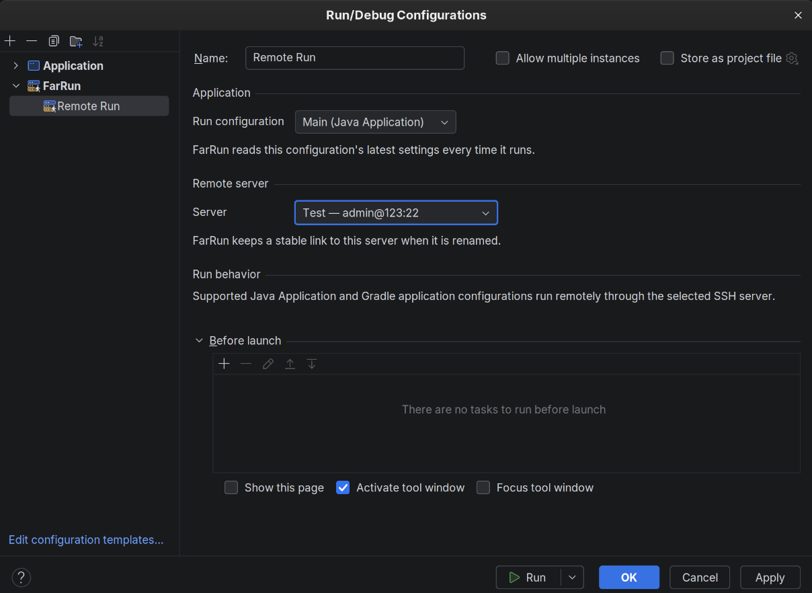
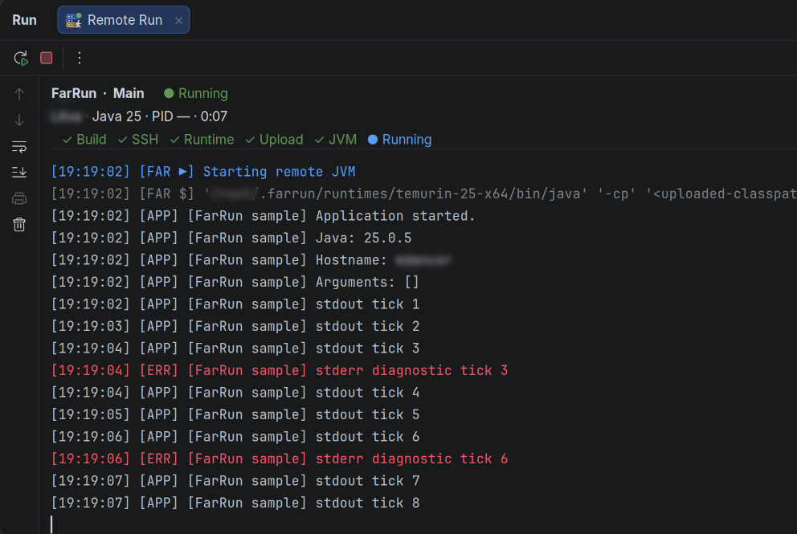

# FarRun

<p align="center">
  
</p>

[](https://plugins.jetbrains.com/plugin/35664-farrun) [](https://openjdk.org/projects/jdk/25/) [](https://gradle.org/) [](https://www.jetbrains.com/idea/)

**FarRun** is an IntelliJ IDEA plugin that builds a Java application locally and runs it on a selected Linux server over SSH. It keeps the familiar IntelliJ Run workflow while making remote execution visible: connection, Java runtime, upload, JVM lifecycle, application output, and failures all remain in the standard Run tool window.

## What it does

- Runs IntelliJ **Java Application** configurations remotely.
- Runs supported Gradle application tasks: `run`, `bootRun`, and `bootJar`.
- Compiles/builds locally, uploads the resolved runtime classpath through SFTP, then starts the remote JVM.
- Detects the required Java major version and provisions a user-owned Eclipse Temurin runtime on the server when needed.
- Stores passwords, private-key passphrases, and host-key data in the IDE Password Safe.
- Provides a per-run status panel for build, SSH, runtime, upload, JVM start, and process state.
- Separates FarRun lifecycle records from remote application stdout and stderr in the normal Run console.
- Supports Stop and Rerun through the standard IntelliJ Run controls.

## Requirements

- IntelliJ IDEA 2026.2 or newer.
- JDK 25 or newer, selected as the Gradle JVM when developing the plugin.
- A reachable Linux host with SSH and SFTP enabled.
- Password authentication or an OpenSSH private key for the remote server.

FarRun does not require root access on the remote machine. Managed Java runtimes are stored below `~/.farrun/runtimes` for the SSH user.

## Configure an SSH server

Open **Settings | Tools | FarRun** and add a server. Enter its display name, hostname, port, username, and either a password or private key. Use **Test Connection** before saving.



## Create a FarRun run configuration

1. Open **Run | Edit Configurations…** and add a **FarRun** configuration.
2. Select an existing Java Application or supported Gradle application configuration.
3. Select the saved remote server.
4. Run it as usual.

FarRun reads the source configuration’s latest class, VM, and program arguments for every launch.



## Run console

The regular Run tool window remains the console. FarRun adds a compact status header with the selected server, required Java version, elapsed time, lifecycle state, and confirmed milestones:

`Build → SSH → Runtime → Upload → JVM → Running`

FarRun messages are rendered with native IntelliJ console colors. Application stdout stays neutral, stderr stays in the IDE error style, and stack traces remain available in the same console. A lost SSH connection is reported as **Connection Lost / process status unknown**, not as a stopped process.



## Develop the plugin

Open the repository as a Gradle project and run an isolated IDE:

```bash
./gradlew runIde
```

Build the plugin ZIP:

```bash
./gradlew buildPlugin
```

The ZIP is written to `build/distributions/`. Install it in a regular IDE through **Settings | Plugins | ⚙ | Install Plugin from Disk…**.

## Checks

```bash
./gradlew test
./gradlew verifyPlugin
```

To reuse an already installed target IDE while developing:

```bash
./gradlew build -PlocalIdeaPath=/path/to/idea
```
